# AI Vision-Motor & Sports Reflex Assessment and Training System

An affordable, portable, and smart training system combining LED reaction targets, balance tracking, wearable motion sensors (IMUs), and AI pose estimation to assess and train reaction speed, peripheral vision, balance, and coordination.

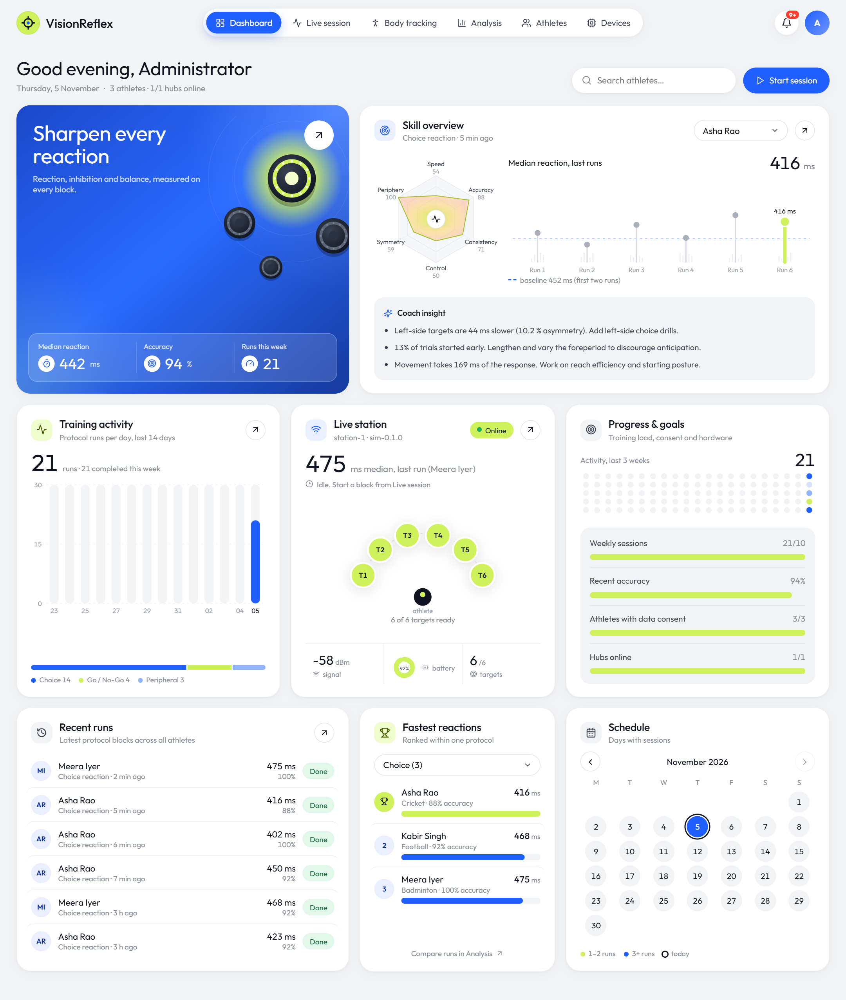

## Repository Contents

- **[`frontend/`](frontend/README.md)**: coach dashboard (React + TypeScript): dashboard, live session, body tracking (webcam + MediaPipe Pose in the browser), analysis, athletes, devices.
- **[`backend/`](backend/README.md)**: FastAPI API, device gateway, analysis engine (reaction scoring, decision/movement split, balance), hub simulator.
- **[`firmware/`](firmware/README.md)**: reference ESP32-S3 hub firmware for the 6 touch-sensor targets, wrist IMU and balance board.
- **[`docs/`](docs/README.md)**: project and dashboard documentation (see [Documentation](#documentation) below), plus the [screenshots](docs/screenshots/).
- **`info/`**
  - [`Sports Vision & Reflex System Documentation.md`](info/Sports%20Vision%20&%20Reflex%20System%20Documentation.md): Comprehensive system documentation, hardware architecture, sensor integration, state machines, and implementation blueprints.
  - `EyeInnovate_Components_Software_Datasets.pdf`: Component specifications, software overview, and dataset details.
  - `Sports_Vision_Assessment_Training_Report.pdf`: System assessment and training research report.

## Quick start (laptop, simulated hub)

From `backend/`, run each in its own terminal:
1. `python -m svs.broker --lan`
2. `uvicorn --factory svs.main:create_app`
3. `python -m svs.simulator --discover`

Then, from `frontend/`, run `npm install && npm run dev` and open the URL it prints. First-time install (virtual environment, database, admin account) is in [Setup and operations](docs/setup-and-operations.md).

## Documentation

| Document | For |
|---|---|
| [Project overview](docs/project-overview.md) | What the system is, the physical setup, key ideas, vocabulary, one run end to end |
| [Dashboard guide](docs/dashboard-guide.md) | Coaches and therapists: every page and card, with screenshots |
| [Metrics reference](docs/metrics-reference.md) | Exactly how each number is calculated: classification, RT statistics, d′, decision/movement split, balance, skill radar, insights, baselines |
| [Setup and operations](docs/setup-and-operations.md) | Install, run, simulator options, real hardware, open access, settings, backups, alerts, troubleshooting |
| [Architecture](docs/architecture.md) | Developers: components, data model, run lifecycle, gateway, frontend, security, tests |
| [API reference](docs/api-reference.md) | Endpoints, roles, request bodies and the live WebSocket feed |
| [Hub MQTT data scheme](docs/hub-mqtt-data-scheme.md) | Firmware: the message contract the ESP32-S3 hub must implement |

The [docs index](docs/README.md) has reading paths for each role.

## Screenshots

Captured from the running system with the simulated hub (and, for body tracking, the simulated athlete); all data is real output of the analysis engine.

### Live session

A block running on the hub's 6 touch-sensor targets. The screen shows:
- the lit target (T1), trial progress, the response feed with classification and live KPIs
- centre of pressure from the balance board and wrist-motion bursts
- body tracking, with the athlete reaching for the same target, and an always-visible E-STOP

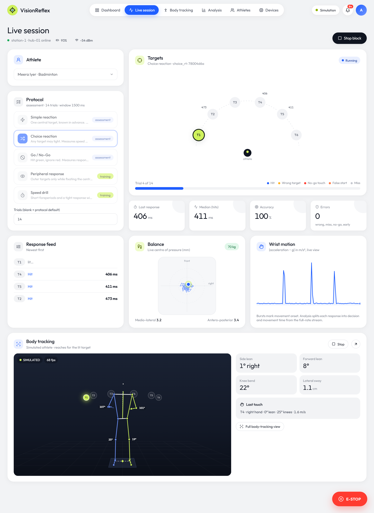

### Body tracking

A webcam feed with a 33-point skeleton (MediaPipe Pose, running in the browser; video is never recorded or uploaded). The page shows:
- live trunk lean, tilts and joint angles (left vs right)
- 20 s of sway and lean
- a framing checklist
- the posture at each touch of the current block: the hand used, trunk lean, knee bend and wrist speed

Shown here with the simulated athlete, which reaches for whichever target the hub lights.

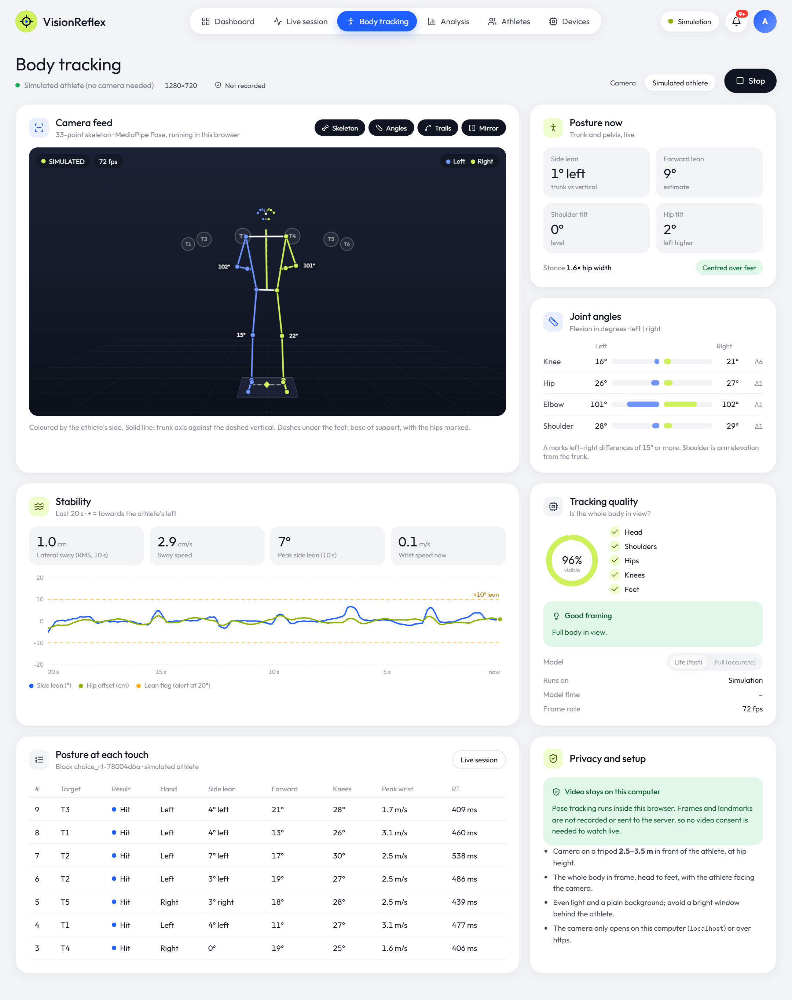

### Analysis report

Per-block scoring:
- median RT, accuracy, d′, consistency and false starts
- a trial-by-trial chart and rule-based coach insights
- RT distribution and a target heatmap
- the decision vs movement split from the wrist IMU, plus left/right and eccentricity comparisons
- balance sway and the full trial table, with CSV export

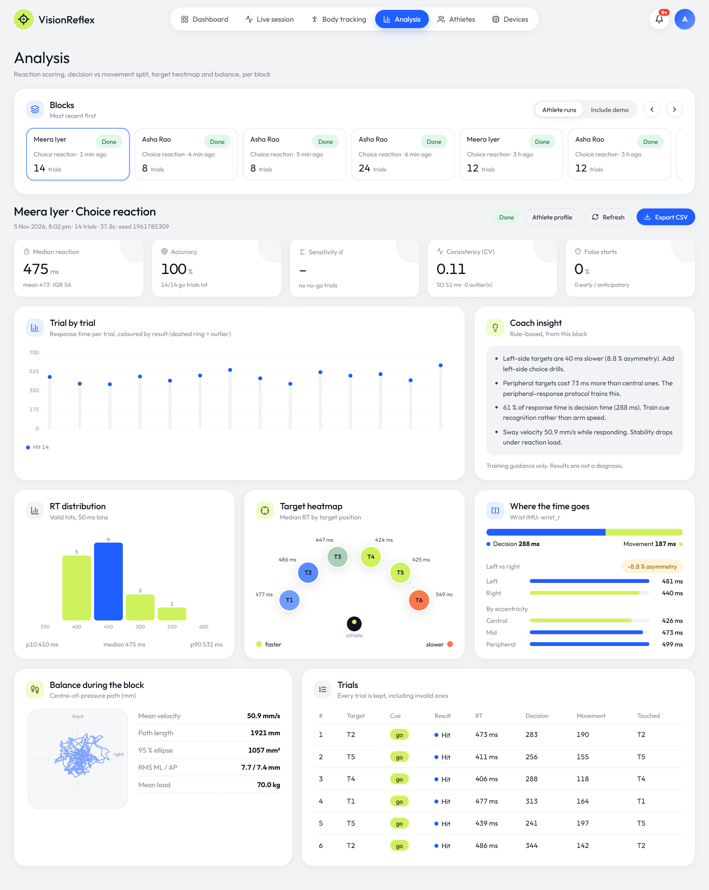

### Athletes

| Athlete list | Athlete profile |
|---|---|
| 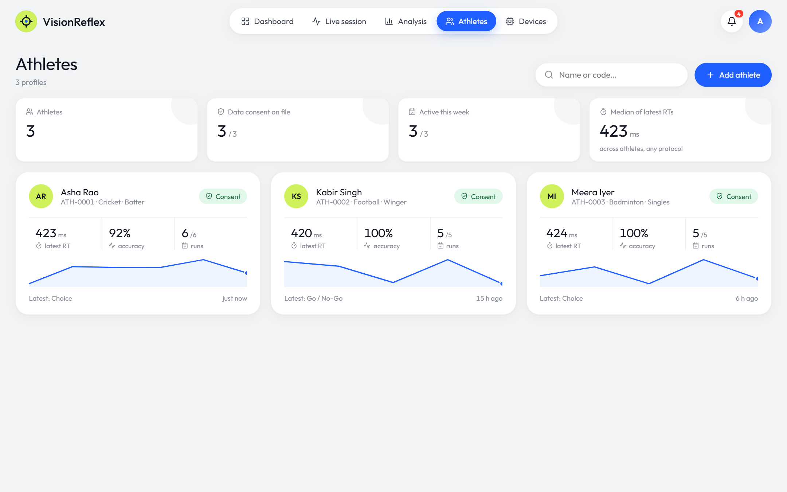 | 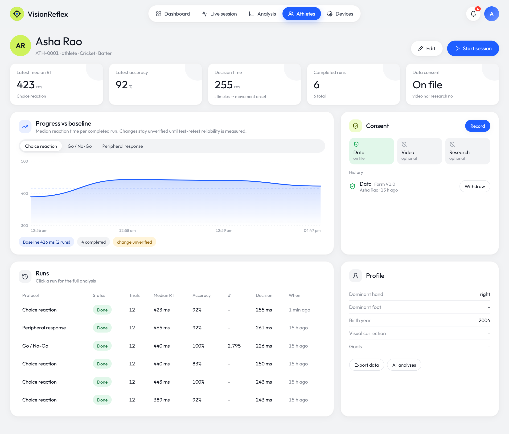 |
| Latest RT, accuracy, runs and trend per athlete; consent status at a glance | Progress vs baseline per protocol, consent records, run history |

### Devices and sign-in

| Devices | Sign-in |
|---|---|
| 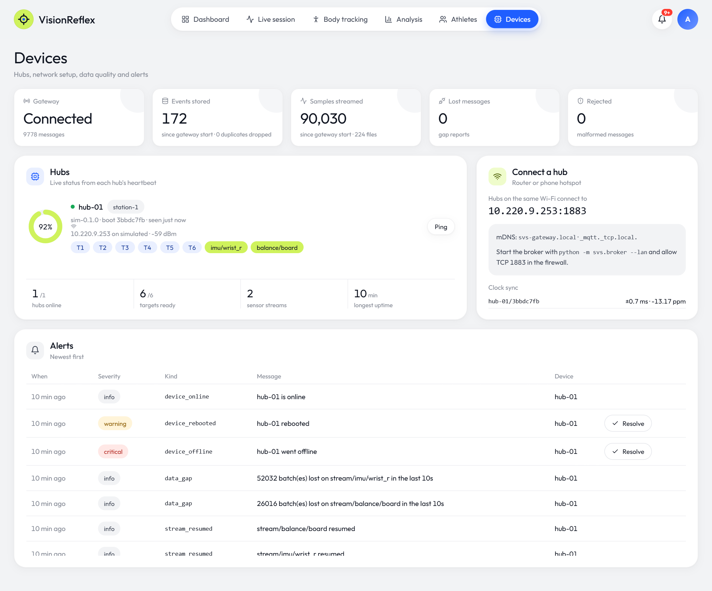 | 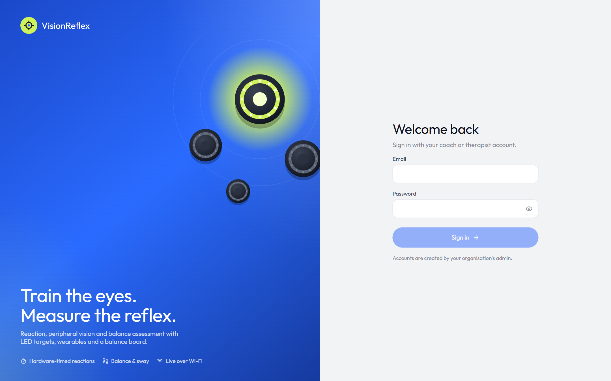 |
| Gateway data quality, hub health, Wi-Fi setup for real hardware, clock sync, alerts | Full-screen sign-in; can be switched off for local use (see `backend/README.md`) |

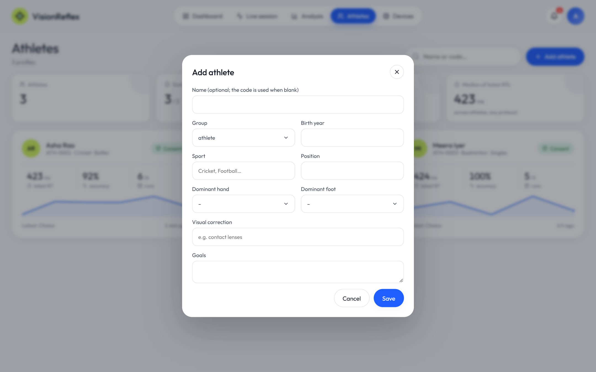

### Tablet and phone

The layout adapts to every width: cards pair up two per row on tablets and stack on phones.

<table>
  <tr>
    <td width="34%">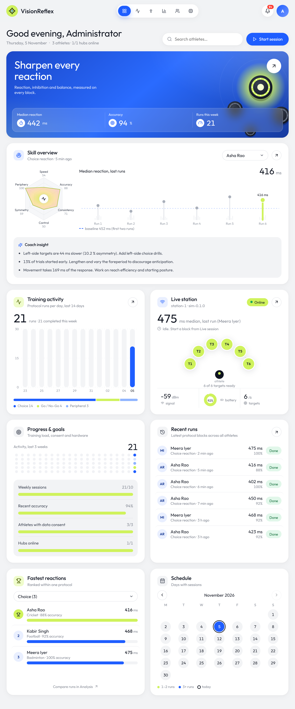</td>
    <td width="22%">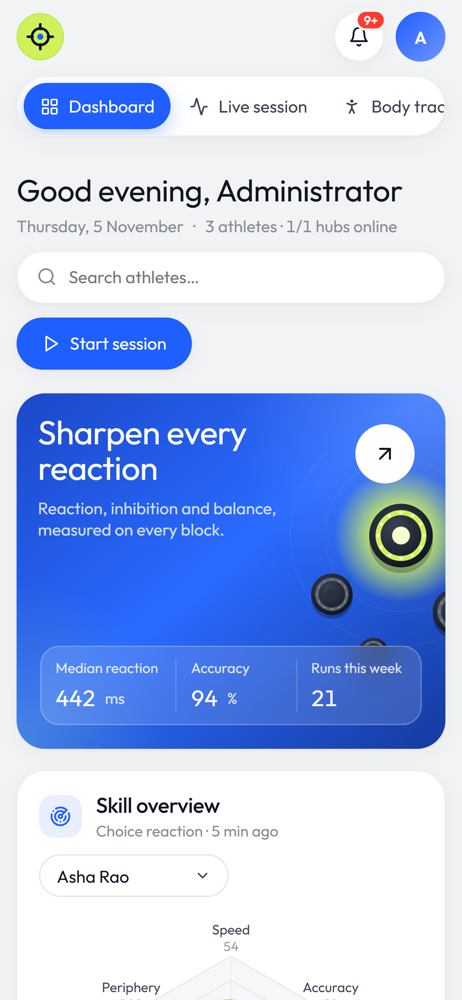 </td>
    <td width="22%">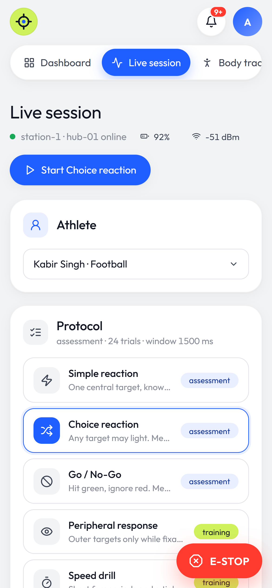 </td>
    <td width="22%"> </td>
  </tr>
  <tr>
    <td>Tablet (1024 px)</td><td>Phone: dashboard</td><td>Phone: live session</td><td>Phone: analysis and runs</td>
  </tr>
  <tr>
    <td></td>
    <td>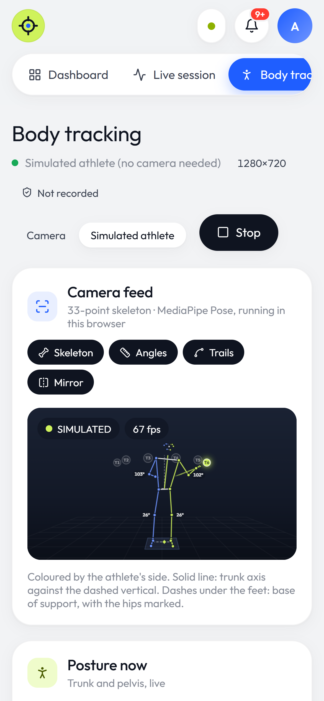</td>
    <td>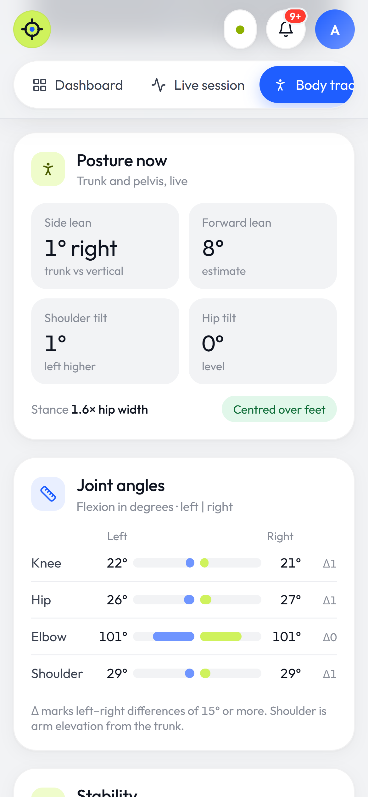</td>
    <td></td>
  </tr>
  <tr>
    <td></td><td>Phone: body tracking</td><td>Phone: posture and joint angles</td><td></td>
  </tr>
</table>
