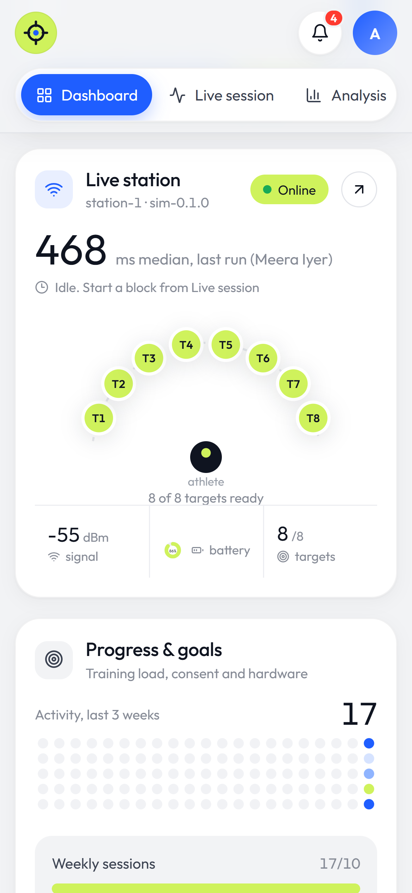
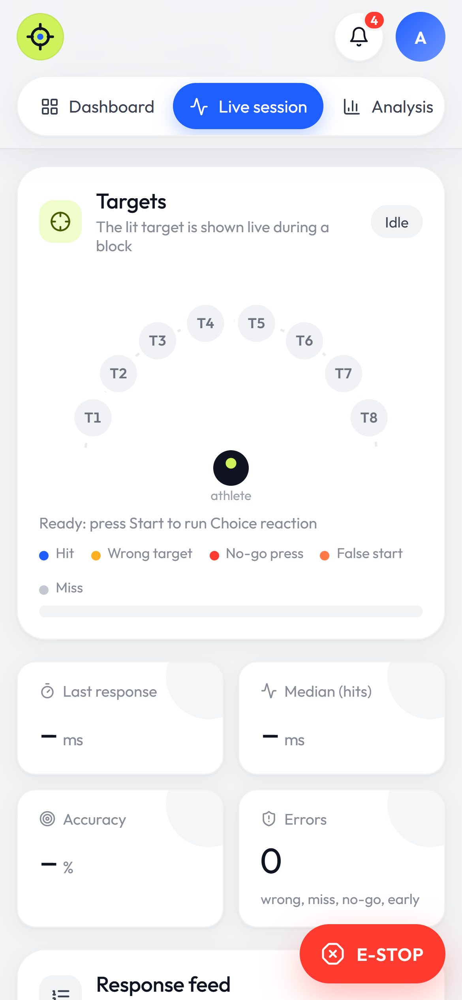
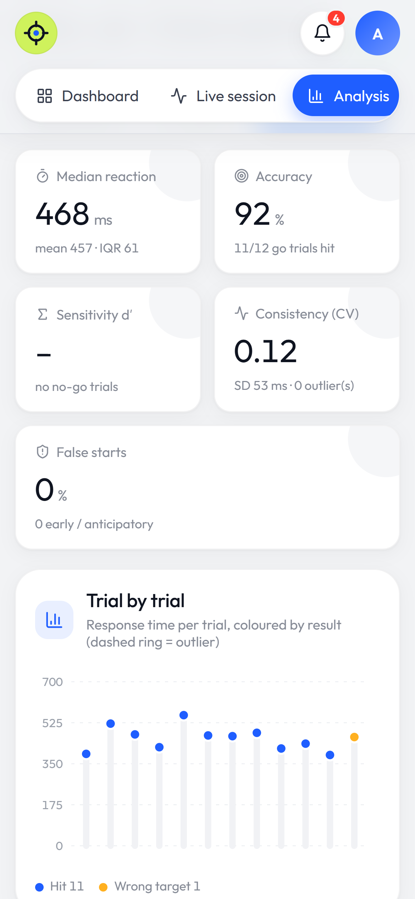
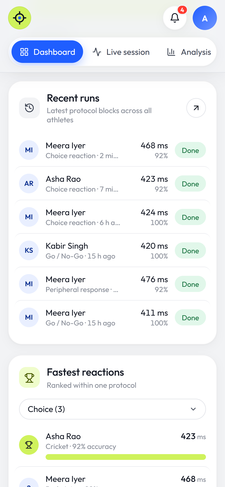

# AI Vision-Motor & Sports Reflex Assessment and Training System

An affordable, portable, and smart training system combining LED reaction targets, balance tracking, wearable motion sensors (IMUs), and AI pose estimation to assess and train reaction speed, peripheral vision, balance, and coordination.

## Repository Contents

- **[`frontend/`](frontend/README.md)**: coach dashboard (React + TypeScript): dashboard, live session, analysis, athletes, devices.
- **[`backend/`](backend/README.md)**: FastAPI API, device gateway, analysis engine (reaction scoring, decision/movement split, balance), hub simulator.
- **[`firmware/`](firmware/README.md)**: reference ESP32-S3 hub firmware.
- **`docs/`**: [dashboard functional research](docs/dashboard-functional-research.md), the [hub MQTT data scheme](docs/hub-mqtt-data-scheme.md) and [screenshots](docs/screenshots/).
- **`info/`**
  - [`Sports Vision & Reflex System Documentation.md`](info/Sports%20Vision%20&%20Reflex%20System%20Documentation.md): Comprehensive system documentation, hardware architecture, sensor integration, state machines, and implementation blueprints.
  - `EyeInnovate_Components_Software_Datasets.pdf`: Component specifications, software overview, and dataset details.
  - `Sports_Vision_Assessment_Training_Report.pdf`: System assessment and training research report.

## Quick start (laptop, simulated hub)

From `backend/`, run each in its own terminal:
1. `python -m svs.broker --lan`
2. `uvicorn --factory svs.main:create_app`
3. `python -m svs.simulator --discover`

Then, from `frontend/`, run `npm install && npm run dev` and open the URL it prints.

## Screenshots

Captured from the running system with the simulated hub; all data is real output of the analysis engine.

### Live session

A block running on the hub: the lit target (T4), trial progress, response feed with classification, live KPIs, centre of pressure from the balance board, wrist-motion bursts and an always-visible E-STOP.

### Analysis report

Per-block scoring:
- median RT, accuracy, d′, consistency and false starts
- a trial-by-trial chart and rule-based coach insights
- RT distribution and a target heatmap
- the decision vs movement split from the wrist IMU, plus left/right and eccentricity comparisons
- balance sway and the full trial table, with CSV export

### Athletes

| Athlete list | Athlete profile |
|---|---|
|  |  |
| Latest RT, accuracy, runs and trend per athlete; consent status at a glance | Progress vs baseline per protocol, consent records, run history |

### Devices and sign-in

| Devices | Sign-in |
|---|---|
|  |  |
| Gateway data quality, hub health, Wi-Fi setup for real hardware, clock sync, alerts | Full-screen sign-in; can be switched off for local use (see `backend/README.md`) |

### Tablet and phone

The layout adapts to every width: cards pair up two per row on tablets and stack on phones.

<table>
  <tr>
    <td width="34%"></td>
    <td width="22%"> </td>
    <td width="22%"> </td>
    <td width="22%"> </td>
  </tr>
  <tr>
    <td>Tablet (1024 px)</td><td>Phone: dashboard</td><td>Phone: live session</td><td>Phone: analysis and runs</td>
  </tr>
</table>
