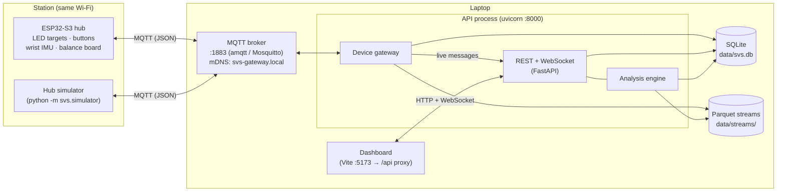
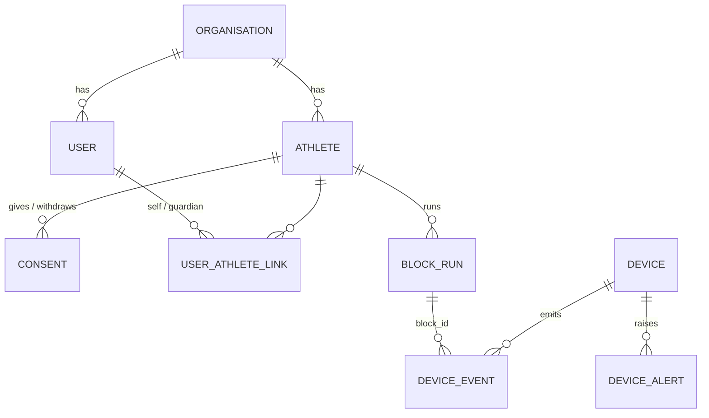
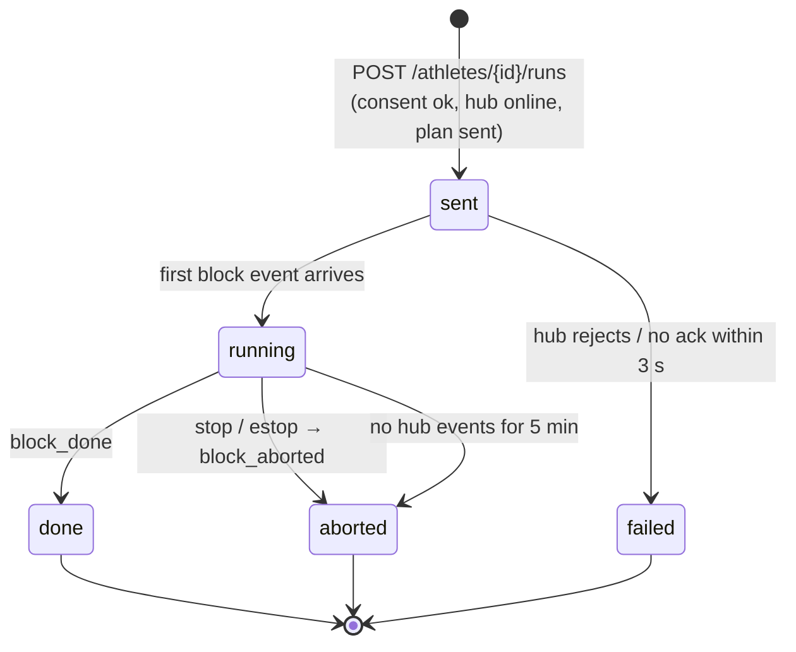

# Architecture

This document explains how the system is put together: the processes, how data flows between them, where it's stored, and how reliability and security are handled. For the "what and why", read the [Project overview](project-overview.md) first.

---

## Components



| Process | Command | Port | Role |
|---|---|---|---|
| MQTT broker | `python -m svs.broker --lan` | 1883 | Message bus between hubs and the gateway. With `--lan` it listens on the Wi-Fi network and advertises itself over mDNS |
| API + gateway | `uvicorn --factory svs.main:create_app` | 8000 | One process: REST API, WebSocket live feed, and the device gateway subscribed to MQTT |
| Dashboard | `npm run dev` (in `frontend/`) | 5173 | React app; proxies `/api/*` (including the WebSocket) to :8000, so the browser needs no CORS |
| Hub | ESP32-S3 firmware, or `python -m svs.simulator` | n/a | Runs blocks, timestamps events, streams sensors |

---

## Backend modules (`backend/svs/`)

| Module | Responsibility |
|---|---|
| `config.py` | All settings (`SVS_*` environment variables or `backend/.env`) |
| `db.py`, `models.py` | SQLAlchemy engine and tables; Alembic migrations in `backend/migrations/` |
| `security.py`, `deps.py` | Argon2 password hashing, JWT, current-user resolution, role checks, athlete visibility, open-access mode |
| `api/` | Routers: `auth`, `users`, `athletes`, `devices`, `runs`, `live` |
| `contract/` | MQTT topic names and Pydantic message schemas shared by gateway, simulator and firmware |
| `transport/` | `MqttTransport` (paho-mqtt) and `MemoryBus` (in-process broker for tests) |
| `gateway/` | `Gateway` (ingest), `SeqTracker` (dupes/gaps), `ClockMapper` (hub→server time), `ParquetSink`, `LiveHub` (WebSocket fan-out) |
| `analysis/` | `scoring.py` (classification and stats), `balance.py` (CoP sway), `protocols.py` (presets and seeded plans), `layout.py` (target geometry), `service.py` (loads a block's events and streams) |
| `simulator/` | `SimHub`: a software hub with a human reaction model and fault injection |
| `network.py`, `broker.py` | LAN IP discovery, mDNS advert/discovery, local broker |
| `manage.py` | CLI: `init-db`, `create-admin` |

---

## Data model



| Table | What it holds |
|---|---|
| `organisations`, `users` | Accounts; role is one of `admin`, `coach`, `therapist`, `athlete`, `patient`, `parent` |
| `athletes` | Profile: anonymised code (`ATH-0001`), group, sport, handedness, goals… |
| `consents` | Type (`data` / `video` / `research`), form version, signer, guardian, signed/withdrawn time |
| `user_athlete_links` | Which athlete/patient/parent login can see which athlete |
| `block_runs` | One protocol run: athlete, protocol, params, **seed**, the exact plan sent, status, cached summary |
| `device_events` | Every hub event (stimulus_on, response…) with hub time, mapped server time and payload. Unique on `(device_id, boot_id, seq)` |
| `devices`, `device_alerts` | Hub registry and health alerts |
| `audit_log` | Append-only record of logins, views, edits, exports, consent changes and commands |

High-rate sensor data is **not** in SQL. It goes to Parquet files:

```
backend/data/streams/{station}/{imu|balance}/{sensor}/{boot_id}/part-{first_t_hub_us}-{rand}.parquet
```

Each part file covers a time span that starts at the timestamp in its name. Analysis reads only the files that overlap the block it's analysing.

---

## Run lifecycle



- **Status from events:** a run's status comes from the hub's events, so it stays correct even if the dashboard was closed while the block ran.
- **Analysis timing:** while a block is running, analysis uses events only, which is cheap enough to poll. Once it's final, the IMU and balance streams are read too, and the summary is **cached** about 15 s later, once the last stream batches have been flushed to disk.
- **Stuck runs:** a block whose hub stopped sending (power loss, reboot) is closed as aborted after 5 minutes, with a reason.

---

## Device gateway

The gateway subscribes to every hub topic, `svs/+/…` (see the [data scheme](hub-mqtt-data-scheme.md)). For each message it:

1. **Validates** it against the contract schema. Anything malformed is rejected with a `bad_message` alert; ingest carries on.
2. **Removes duplicates** by `(device_id, boot_id, channel, seq)`. MQTT QoS 1 can deliver a message twice, and a hub replaying its SD/RAM buffer after an outage resends old events.
3. **Detects gaps**: a missing `seq` that stays missing for 2 s is reported. Lost timing events alert individually; lost stream batches are summarised every 10 s per sensor.
4. **Maps time**: hub µs is converted to server µs using a line fitted to NTP-style ping/pong exchanges every 2 s (offset and drift, with the lowest-latency samples weighted most).
5. **Stores** events in SQL (idempotent) and stream batches in the Parquet buffer, flushed every 5 s or 5000 rows.
6. **Tracks health**: online/offline (heartbeat and MQTT Last-Will), reboots (new `boot_id`), low battery, stalled streams. Each raises an alert.
7. **Publishes live** to WebSocket subscribers: events, alerts and status, plus telemetry throttled to 20 Hz per sensor.

It also sends commands (`start_block`, `stop`, `estop`, `ping`, `config`) and waits for the hub's `ack`; no ack within 3 s raises `command_timeout`.

---

## Frontend (`frontend/src/`)

| File | Role |
|---|---|
| `App.tsx` | App shell: top bar with sliding nav, auth bootstrap (token → open access → login), routes, error boundary |
| `api.ts` | Typed REST client and WebSocket URL builder |
| `lib.ts` | Formatting, colour scales, **skill radar** and **coach insight** rules, `useAsync` polling hook, `useStationFeed` WebSocket hook |
| `charts.tsx` | Hand-built SVG charts: line, bar, lollipop, histogram, sparkline, radar, gauge, dot matrix, target arc/heatmap, CoP plot, trial strip |
| `ui.tsx` | Card, KPI tile, count-up numbers, progress, modal, toasts, status chip, error boundary |
| `pages/` | `Dashboard`, `Live`, `Analysis`, `Athletes`, `AthleteDetail`, `Devices`, `Login` |
| `styles.css` | Design tokens, layout grid, components, animations, responsive rules |

**How data reaches the screen:**
- Pages poll REST every 5–15 s.
- The Live page and the dashboard's Live station card hold a WebSocket to `/api/ws/stations/{station}` and compute live RTs from `stimulus_on`/`response` pairs in the browser.
- Authoritative scoring always comes from the backend analysis.

---

## Security model

- **Authentication:** email + password (Argon2) gives a JWT, valid for 8 h by default.
- **Authorisation:**
  - *Staff* (`admin`, `coach`, `therapist`) see every athlete in their organisation.
  - *Athletes, patients and parents* see only the athletes they're linked to.
  - Other organisations' records return 404, so their IDs aren't revealed.
- **Admin-only:** user management, the audit log and hard-deleting athletes.
- **Open access** (`SVS_OPEN_ACCESS=true`, local prototype only): requests **from this computer** without a token act as the first admin. Requests from other devices still need a login, and a bad token is still rejected.
- **Privacy tools:** per-athlete JSON export, anonymise (identifying fields removed, code kept), hard delete. Consent gates session start.
- **Known gaps:**
  - The dev broker accepts anonymous MQTT; production needs Mosquitto with TLS and per-device credentials.
  - The JWT travels in the WebSocket URL, so it appears in access logs.

---

## Testing

Run `pytest` in `backend/`: 49 tests. They cover:
- **Access:** the role and visibility matrix, organisation isolation and open access
- **Consent and privacy:** the consent rules, plus export, anonymise and delete
- **Gateway:** sequence and clock maths, and simulator ↔ gateway runs under every injected fault (drops, duplicates, outage with backfill, reboot, Last-Will, heartbeat loss, command timeout, e-stop, malformed input)
- **Analysis:** every classification rule, d′ (hand-checked), plan determinism, onset detection, sway on a known circle, stream-file pruning
- **End to end:** a full API → broker → simulator → analysis run, checked against the simulator's ground truth
- **Networking:** LAN and mDNS discovery

The frontend is checked with `npm run typecheck` and `npm run build`, and visually in the browser at 1440, 1280, 1024 and 375 px.
