# Dashboard guide

A page-by-page guide for coaches and therapists. Every number on screen is explained in the [Metrics reference](metrics-reference.md); this guide covers what each part is for and how to use it.

**Contents:** [Signing in](#signing-in) · [Navigation](#navigation) · [Dashboard](#dashboard) · [Live session](#live-session) · [Analysis](#analysis) · [Athletes](#athletes) · [Athlete profile](#athlete-profile) · [Devices](#devices) · [Phones and tablets](#phones-and-tablets) · [Troubleshooting](#troubleshooting)

---

## A typical session in five steps

1. **Athletes → Add athlete** to create the profile (once).
2. On the athlete's profile, **Consent → Record** a *Data* consent (once). Sessions are blocked without it.
3. **Live session:** pick the athlete and a protocol, then press **Start**.
4. Watch the targets, feed and balance live. Press **Stop block** to end early, or **E-STOP** in an emergency.
5. Press **View analysis** for the full report, and check **Progress vs baseline** on the profile over the following weeks.

---

## Signing in

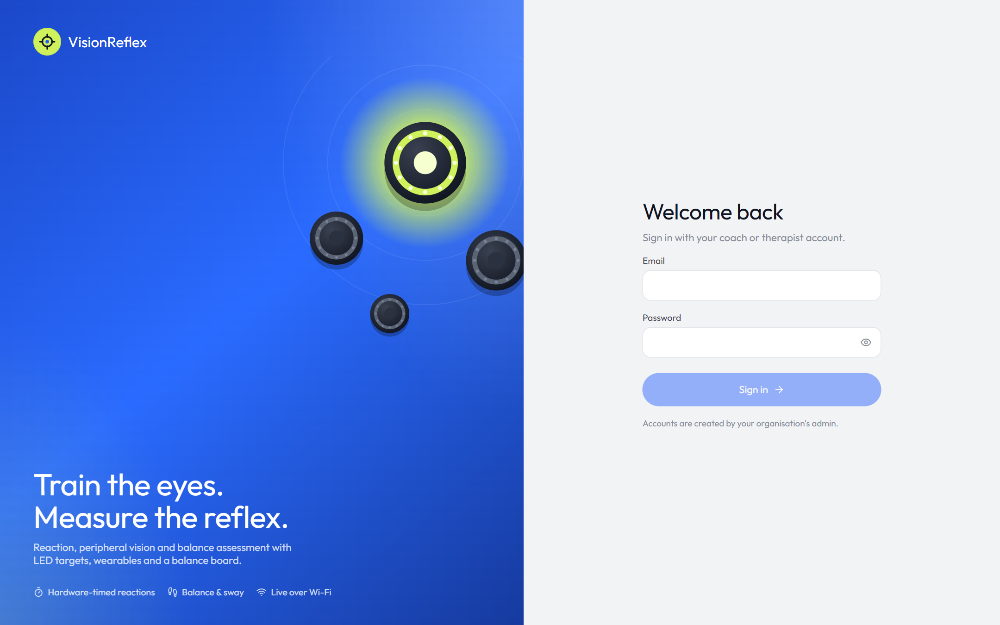

Sign in with the coach or therapist account your admin created. *Show password* is the eye icon.

> **No sign-in on the coaching laptop:** with `SVS_OPEN_ACCESS=true` in `backend/.env`, the dashboard opens directly on that computer. The account menu then shows an **Open access** tag. Other devices on the network still have to sign in. See [Setup and operations](setup-and-operations.md#open-access-no-sign-in).

---

## Navigation

- **Top bar:** stays at the top as you scroll.
  - The **pill menu** switches pages: Dashboard · Live session · Analysis · Athletes · Devices. On tablets it shows icons only; hover to see each name.
  - The **bell** shows the count of open warnings and critical alerts, and opens the Devices page.
  - The **avatar** shows your account and role, plus Sign out (or the Open access note).
- **Arrow buttons (↗)** in card headers open the related page.
- **Esc** or a click outside closes any menu or dialog.

---

## Dashboard

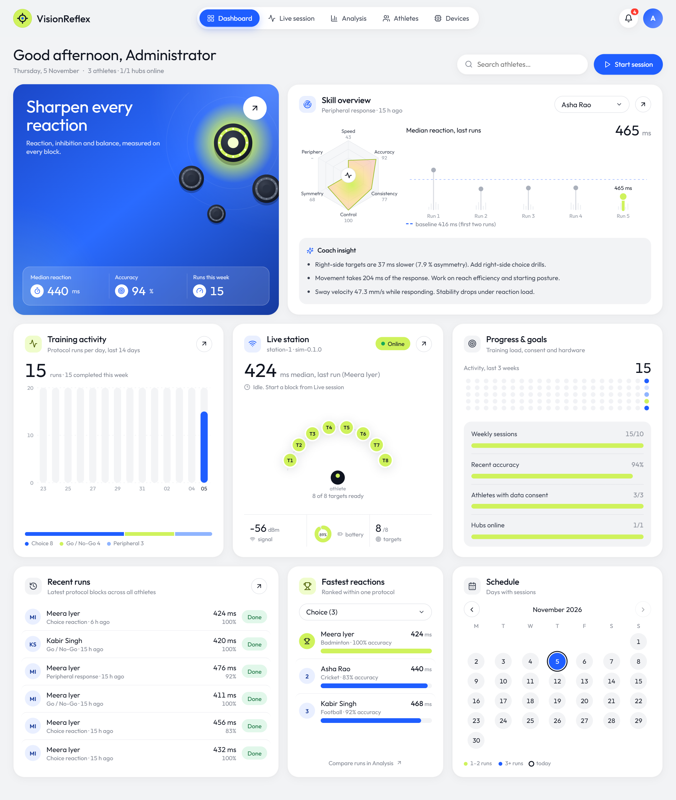

| Card | What it tells you |
|---|---|
| **Greeting line** | Date, number of athletes and how many hubs are online |
| **Hero (blue)** | Median reaction time and mean accuracy over the 20 most recent completed runs, and runs started in the last 7 days. The arrow opens Live session |
| **Skill overview** | For the athlete chosen in the dropdown, from their latest completed run: • the **six-axis radar** (Speed, Accuracy, Consistency, Control, Symmetry, Periphery; 0–100, rules in the [reference](metrics-reference.md#skill-radar)) • median RT of their last runs vs their **baseline** (dashed line) • **Coach insight**: rule-based training suggestions. The arrow opens that run's analysis |
| **Training activity** | Runs per day for the last 14 days (today highlighted in blue), and the **protocol mix** bar underneath |
| **Live station** | Hub status (*Online*, *Running* or *Offline*). During a block it shows the latest response and a live RT trace. When idle, it shows the last run's median and the target layout (lime = target ready). Bottom row: Wi-Fi signal, battery, targets ready |
| **Progress & goals** | An activity dot matrix for the last 3 weeks, and progress bars: weekly sessions (target 10), recent accuracy, athletes with data consent, hubs online |
| **Recent runs** | The latest 6 runs; click one to open its analysis |
| **Fastest reactions** | A leaderboard **within one protocol**, chosen in the dropdown. Bars show each median RT relative to the fastest (shorter RT = fuller bar) |
| **Schedule** | Calendar of days with runs: lime = 1–2 runs, blue = 3+, ring = today. Arrows move between months |

---

## Live session

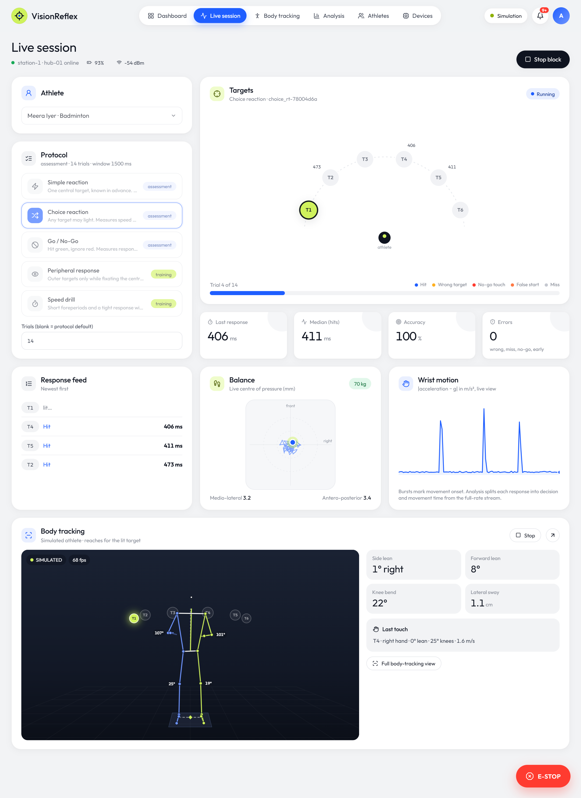

**Before you start:**
1. **Athlete:** choose who is on the station. If data consent is missing you'll see an amber warning with a link to record it, and Start stays disabled.
2. **Protocol:** pick one of five (details in the [reference](metrics-reference.md#protocols)). The tag shows *assessment* (a repeatable measurement) or *training* (practice).
3. **Trials:** leave blank for the protocol default, or enter 1–64.
4. **Start:** the button names the protocol. If it's disabled, the hint beside it says why (*Hub offline*, *Choose an athlete* or *Data consent missing*).

**During the block:**
- **Targets arc:**
  - The **lit target pulses** in its cue colour: green = go, red = no-go.
  - On a press it flashes the result colour: blue hit, amber wrong target, red no-go press, orange early.
  - The number beside each target is its latest RT.
- **Progress:** *Trial n of N* and the progress bar.
- **KPI tiles:** last response, median of hits, accuracy and error count. These are computed live in the browser; the Analysis page is authoritative.
- **Response feed:** the newest result per trial, e.g. "Wrong target (pressed T7)".
- **Balance:** a live centre-of-pressure dot with a trail, the load in kg, and medio-lateral and antero-posterior position in mm.
- **Wrist motion:** acceleration deviation from gravity. Each burst is a reach.

**Stopping:**
- **Stop block** ends the block cleanly; the run is marked *aborted*.
- **E-STOP** (red, bottom right, always visible) turns all targets off immediately, even when no block is running from this page.
- After a block finishes, **View analysis** appears next to Start.

---

## Analysis

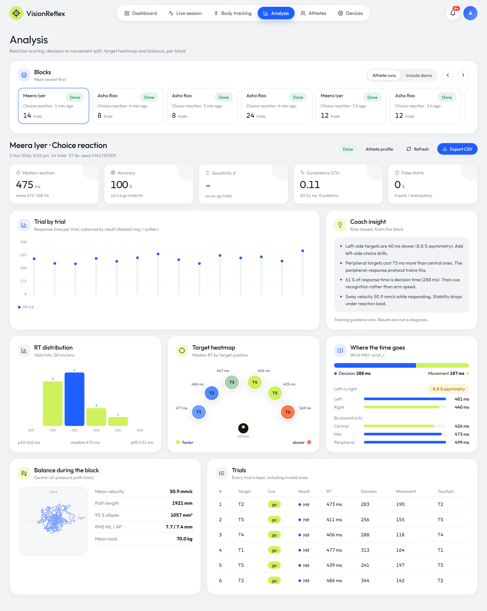

**Blocks rail (top):**
- Recent blocks as cards: athlete, protocol, age, trial count and status. Scroll with the arrows.
- *Athlete runs* / *Include demo* toggles blocks that the simulator ran without an athlete.
- The selected card has a blue outline.

**Report header:** athlete · protocol, date and time, trial count, duration, **seed** (to repeat the exact sequence), status. Buttons: **Athlete profile**, **Refresh**, **Export CSV** (one row per trial; the header notes the protocol, seed and "not a diagnosis").

| Section | How to read it |
|---|---|
| **KPI tiles** | Median reaction (with mean and IQR), accuracy (hits / go trials), sensitivity d′ (only with no-go trials), consistency CV, false starts |
| **Trial by trial** | One dot per trial, its RT, coloured by result. A dashed ring marks an outlier, kept but excluded from the statistics. Hover for details |
| **Coach insight** | Rule-based suggestions from this block ([rules](metrics-reference.md#coach-insights)) |
| **RT distribution** | Valid hits in 50 ms bins; the bin holding the median is blue. p10 / median / p90 underneath |
| **Target heatmap** | Each target coloured by its median RT, lime (fastest) to orange (slowest), with the ms beside it. "no hits" means the target lit but was never hit correctly |
| **Where the time goes** | Decision vs movement split from the wrist IMU, left vs right side with the asymmetry %, and central / mid / peripheral bands. Lime marks the fastest group |
| **Balance during the block** | The CoP path plus mean velocity, path length, 95 % ellipse area, RMS ML/AP and mean load. "Nobody was standing on the board" means the load was under 10 kg |
| **Trials** | Every trial, including invalid ones: target, cue, result, RT, decision, movement, the target actually pressed |

> **Results appear in two stages.** While a block is running, results come from the events only. Decision time and balance fill in once the block ends. The summary is finalised about 15 s after the end, once the last sensor data is on disk.

---

## Athletes

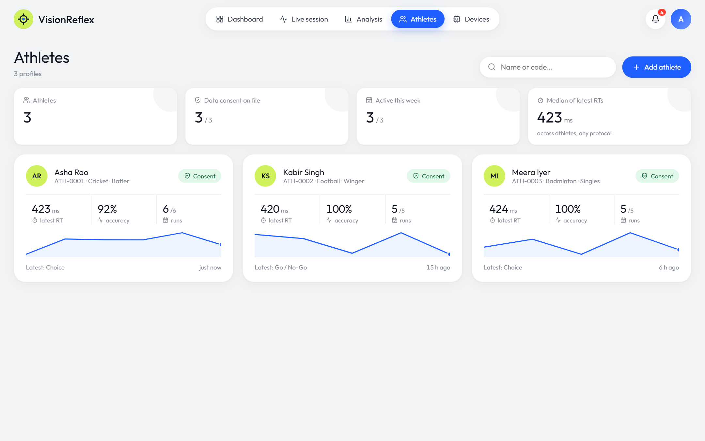

- **Summary tiles:** number of athletes, data consent on file, athletes active this week, and the median of each athlete's latest RT.
- **Athlete cards:**
  - name, code, sport and position, plus a consent badge
  - latest RT, accuracy and completed/total runs
  - a **trend line** of recent median RTs, and the latest protocol with how long ago it ran
- **Search:** filters by name or code as you type.
- **Add athlete:**

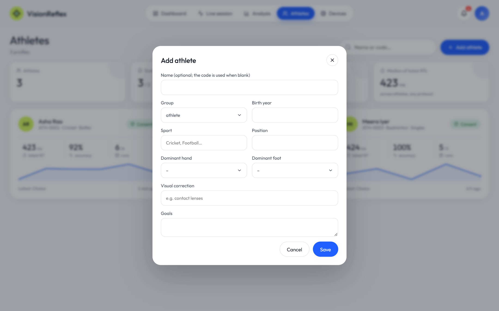

Only *Group* is required. A blank name uses the generated code (`ATH-000n`), and a birth year under 18 years ago (or the *child* group) marks the athlete as a minor, which requires a guardian on consent.

---

## Athlete profile

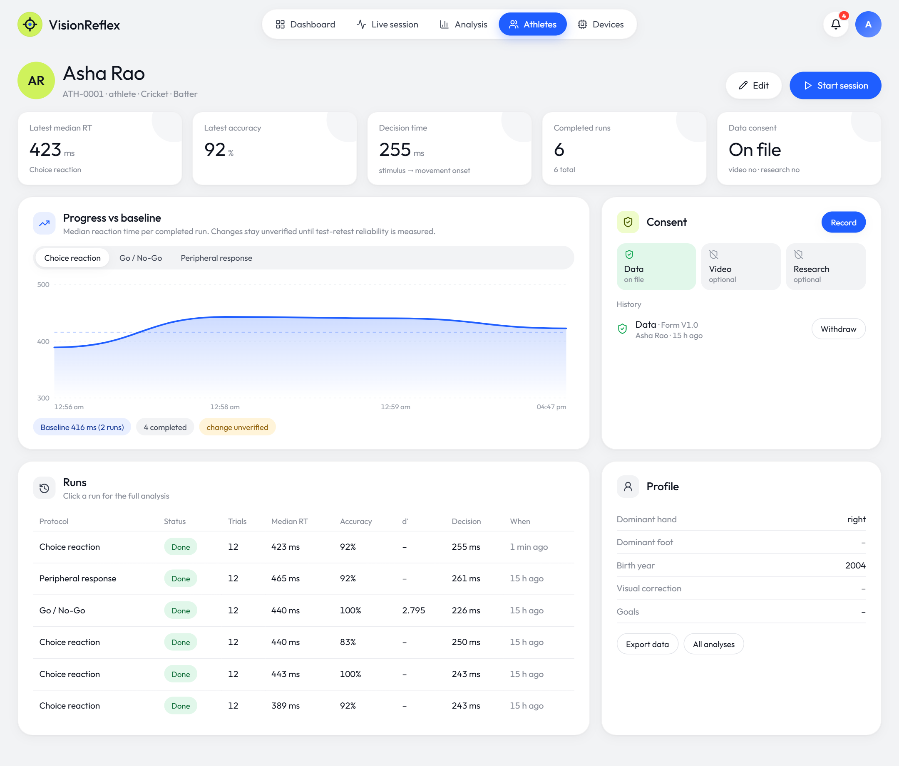

| Section | Use |
|---|---|
| **KPI tiles** | Latest median RT and accuracy, decision time, completed runs, consent status |
| **Progress vs baseline** | Median RT per completed run for the selected protocol tab. The dashed line is the **baseline**: the mean of the first two completed runs with enough valid hits. Hover a point for its accuracy and % change vs baseline. Change stays *unverified* until reliability has been measured |
| **Consent** | Tiles for Data (required), Video and Research (optional), and the history below. **Record** adds a consent: a new one of the same type supersedes the old one, and minors need a guardian. **Withdraw** ends it; staff, the athlete or a linked guardian can withdraw |
| **Runs** | Every run with status, trial count, median RT, accuracy, d′ and decision time. Click a row for its analysis |
| **Profile** | Handedness, footedness, birth year, visual correction, goals. **Edit** changes them; **Export data** downloads everything held about the athlete as JSON |
| **Start session** | Opens Live session with this athlete preselected (disabled without data consent) |

---

## Devices

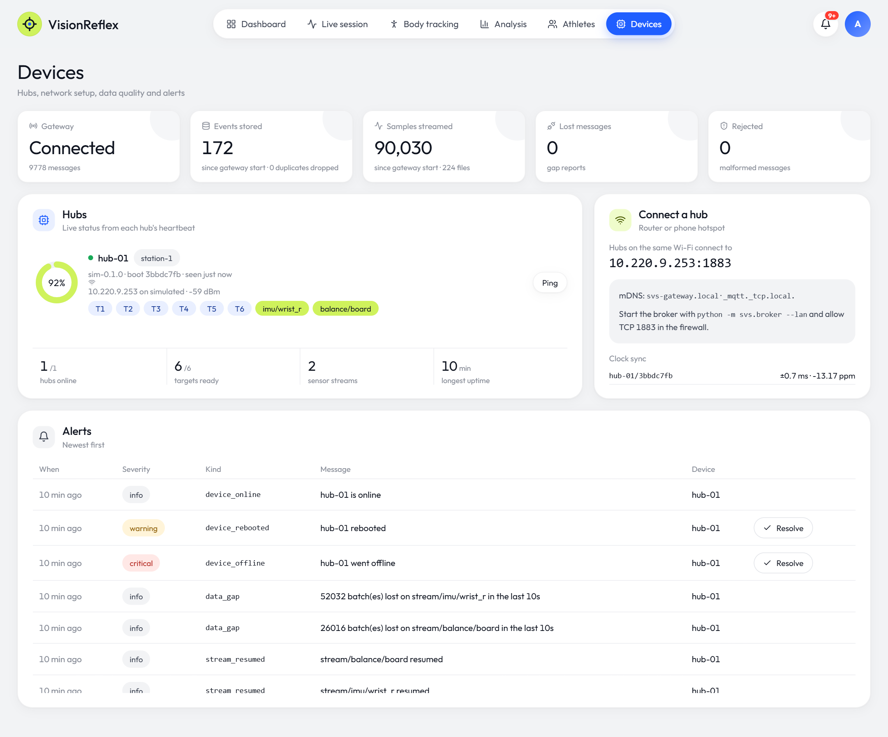

| Section | What to check |
|---|---|
| **KPI tiles** | Gateway connection and message count; events stored and duplicates dropped; sensor samples streamed and Parquet files; lost messages (gap reports); rejected (malformed) messages. Counts run *since gateway start* |
| **Hubs** | Per hub: battery ring, online dot, station, firmware, boot ID, last seen, IP/SSID/signal, target chips (blue = OK, red = offline) and sensor streams. **Ping** checks the round trip. The summary row shows hubs online, targets ready, sensor streams and longest uptime |
| **Connect a hub** | The `IP:1883` address a hub on the same Wi-Fi should use, the mDNS name, and the clock-sync quality per hub (± uncertainty in ms, drift in ppm) |
| **Alerts** | Newest first. *Info* items (online, resumed) need no action; resolve *warning* and *critical* ones once handled. Kinds are listed in [Setup and operations](setup-and-operations.md#alerts) |

---

## Phones and tablets

The dashboard works on any screen. On a tablet, cards pair up two per row; on a phone they stack, and the menu scrolls sideways.

| Tablet | Phone |
|---|---|
| 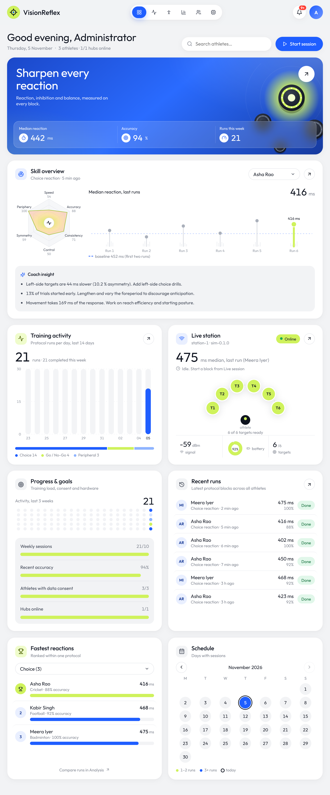 | 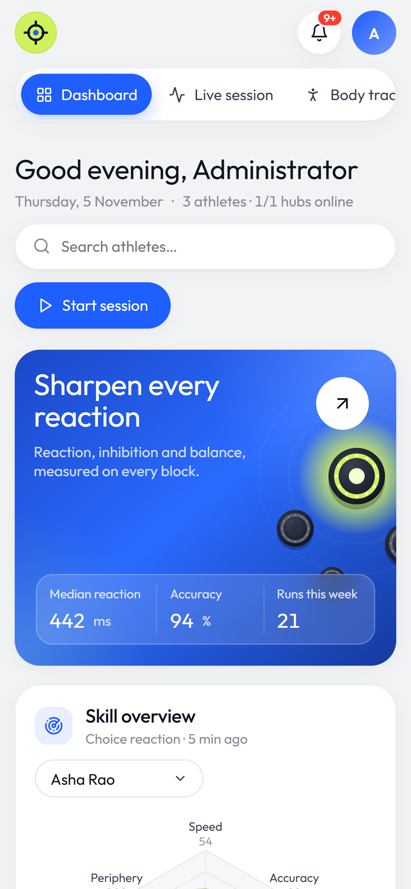 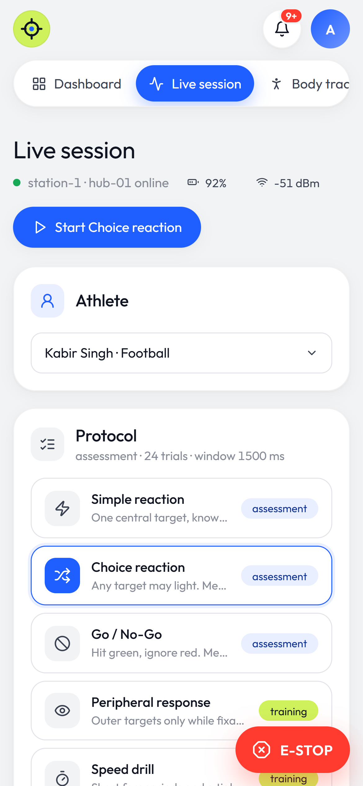 |

---

## Troubleshooting

| Symptom | Likely cause and fix |
|---|---|
| **Start is disabled** | Read the hint next to it: hub offline, no athlete selected, or no data consent |
| **"Hub offline"** | Hub not powered or not on Wi-Fi, or the broker isn't running. On Devices, check *Connect a hub*; for real hardware, the laptop firewall must allow TCP 1883 |
| **Start → "Hub rejected the block"** | The hub is already running a block (stop it first), or the plan names a target it doesn't have |
| **Start → timeout (504)** | The hub didn't acknowledge within 3 s. Check its Wi-Fi signal on Devices |
| **Decision time / balance shows "–"** | No wrist IMU or balance stream during the block, or the block finished seconds ago. Press Refresh after ~15 s |
| **A run stays "Running"** | It finishes when the hub sends `block_done`; if the hub went silent, the run is closed as aborted after 5 min |
| **Lost messages > 0** | Weak Wi-Fi. Timing events are re-sent where possible; sensor gaps only affect sway and onset for the affected seconds |
| **Blank page after an update** | Hard-refresh the browser (Ctrl+F5). The error panel's **Retry** re-renders a section that failed |
