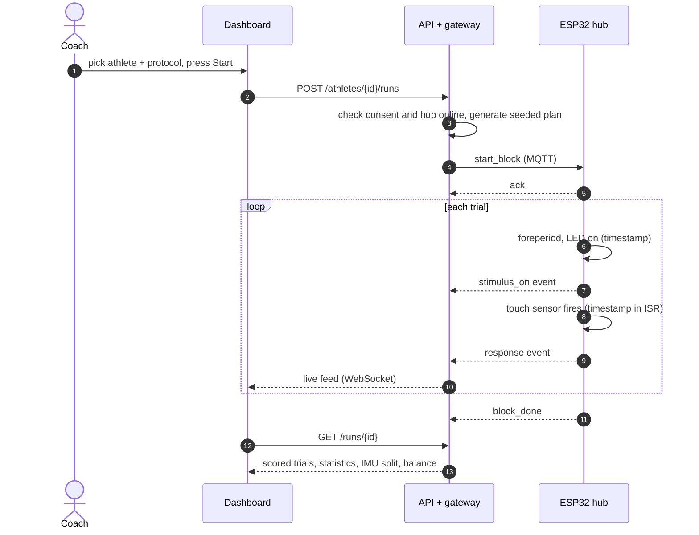

# Project overview

**VisionReflex** (the AI Vision-Motor & Sports Reflex Assessment and Training System) measures and trains how fast and how accurately a person reacts to what they see, and how stable they stay while doing it. A coach runs short blocks of trials on LED targets. The system times every response in hardware and turns the results into analysis on a web dashboard.

> **Scope:** this is a training and assessment aid, not a diagnostic device. Changes over time are reported as *unverified* until test-retest reliability has been measured; see [Metrics reference](metrics-reference.md#baselines-and-trends).

---

## Who it is for

| User | Typical use |
|---|---|
| **Coaches** (cricket, football, badminton, tennis, boxing…) | Train reaction speed, peripheral awareness and decision-making; compare athletes within the same protocol |
| **Therapists / physiotherapists** | Track recovery with controlled reaction and balance tasks; watch for asymmetry between sides |
| **Athletes, patients, parents** | Accounts exist for linked access to their own records (a dedicated view is planned) |

---

## The physical setup

```
        T1     T2     T3   T4     T5     T6     ← 6 touch-sensor targets on an arc
      −70°   −42°   −14°  +14°   +42°   +70°       (LED ring + touch sensor each)
          ╲     ╲      ╲  ╱      ╱     ╱
              athlete  ← wrist IMU (motion)
           [balance board]  ← 4 load cells (centre of pressure)

              [webcam on a tripod]  ← body tracking (33-point skeleton)
```

- **ESP32-S3 hub:** drives the LED targets and reads the touch sensors, the wrist IMU and the balance board. It timestamps every event on its own clock, in microseconds.
- **Targets (T1–T6):** six LED rings that light up green (go) or red (no-go). Each has a **touch sensor** the athlete hits, wired to its own interrupt pin on the hub.
- **Wrist IMU (MPU6050):** detects the moment the hand starts moving, which splits each response into *decision time* and *movement time*.
- **Balance board (4 × load cell):** gives the centre of pressure (CoP), so sway can be measured while the athlete responds.
- **Webcam:** films the athlete from the front. The dashboard runs **MediaPipe Pose** in the browser and draws a 33-point skeleton with trunk lean, joint angles and sway. Video never leaves the laptop.
- **Laptop:** runs the MQTT broker, the API with its device gateway, and the dashboard. The hub and the laptop join the same Wi-Fi network (a router or phone hotspot).

Software stand-ins cover all of this:
- the **hub simulator** replaces the hardware;
- the **simulated athlete** replaces the camera.

So the whole system can be built, demonstrated and tested without electronics.

---

## Key ideas

**1. Timing comes from hardware, never the network.**
Reaction time = `response.t_us − stimulus_on.t_us`. Both timestamps are taken by the hub at the moment the LED latches and the touch-sensor interrupt fires, so Wi-Fi delay never enters the measurement. The server only maps hub time to wall-clock time, for charts and for joining data from different devices.

**2. Assessment and training are different things.**
*Assessment* protocols (simple, choice, go/no-go) are repeatable measurements. *Training* protocols (peripheral, speed drill) are practice. Every run stores its protocol, parameters and random **seed**, so the exact trial sequence can be regenerated.

**3. Nothing is silently dropped.**
Every trial is kept and classified: hit, wrong target, miss, false start, anticipation, no-go touch, correct rejection or invalid. Outliers are *flagged*, not deleted. Lost messages, duplicates and reboots are detected and reported as alerts.

**4. Consent first.**
A run can't start unless the athlete has active **data** consent on file. Minors need a guardian named on the consent. Video and research consent are recorded separately.

**5. Compare like with like.**
Rankings and trends are always within one protocol. Baselines are per athlete (their first two completed runs), not population norms.

---

## Vocabulary

| Term | Meaning |
|---|---|
| **Station** | One hub and its targets/sensors, e.g. `station-1` |
| **Protocol** | A kind of block: simple RT, choice RT, go/no-go, peripheral or speed drill |
| **Run / block** | One execution of a protocol for one athlete. A *run* is the dashboard record; the *block* is what the hub executes (`block_id`) |
| **Trial** | One stimulus: foreperiod → LED on → response (or timeout) → LED off |
| **Foreperiod** | The random wait before the light comes on; touching a target during it is a *false start* |
| **Window** | How long the athlete has to respond after the light |
| **Go / no-go** | Green = hit it; red = don't touch it |
| **RT** | Response time, from stimulus to hit, in ms |
| **Decision (pre-motor) time** | Stimulus → movement onset (from the wrist IMU) |
| **Movement time** | Movement onset → hit |
| **d′ (d-prime)** | How well the athlete tells go from no-go (signal detection) |
| **CoP** | Centre of pressure on the balance board, in mm |
| **Body tracking** | Camera pose estimation (MediaPipe, 33 landmarks): trunk lean, joint angles, sway and the hand used at each touch |
| **Boot ID / seq** | Identify one power-on of a hub and the order of its messages; used to detect lost or duplicate data |

---

## What happens in one run



Meanwhile the hub streams IMU samples (100 Hz) and balance-board samples (50 Hz). The gateway stores them as Parquet files. Once the block finishes, the analysis reads the part of each stream that covers the block.

---

## Repository map

| Folder | Contents | Start here |
|---|---|---|
| `frontend/` | Coach dashboard (React + TypeScript + Vite) | [frontend/README.md](../frontend/README.md) |
| `frontend/src/pose/` | Body tracking in the browser: MediaPipe Pose, posture metrics, skeleton drawing, simulated athlete | [Metrics reference](metrics-reference.md#body-tracking) |
| `backend/svs/api/` | REST + WebSocket API (FastAPI) | [API reference](api-reference.md) |
| `backend/svs/gateway/` | MQTT ingest: dedupe, gaps, clock sync, Parquet, alerts | [Architecture](architecture.md#device-gateway) |
| `backend/svs/analysis/` | Scoring, statistics, onset detection, balance, protocols | [Metrics reference](metrics-reference.md) |
| `backend/svs/simulator/` | Software ESP32 hub | [Setup and operations](setup-and-operations.md#simulator-options) |
| `backend/svs/contract/` | MQTT topics and message schemas | [Hub MQTT data scheme](hub-mqtt-data-scheme.md) |
| `firmware/svs_hub/` | Reference ESP32-S3 firmware (not yet compiled on hardware) | [firmware/README.md](../firmware/README.md) |
| `docs/` | These documents, the original research and screenshots | [docs/README.md](README.md) |
| `info/` | Original project documentation and reports (PDF/MD) | |

---

## Current status

| Area | State |
|---|---|
| Backend API, auth, consent, audit | Done, tested |
| Device gateway (MQTT ingest, clock sync, alerts) | Done, tested |
| Analysis engine (scoring, IMU split, balance) | Done, validated against simulator ground truth |
| Coach dashboard (6 pages, live session) | Done, checked on desktop, tablet and phone |
| Body tracking (webcam + MediaPipe Pose in the browser, simulated athlete) | Done: live view, posture and joint angles, sway, posture at each touch. Tested end to end with the simulated athlete, and the MediaPipe runtime and model are verified; **not yet tried with a webcam on the real station**. Nothing is recorded yet |
| Router/hotspot networking (mDNS discovery) | Done, tested |
| ESP32-S3 firmware | Written against the contract; **not yet compiled or run on hardware** |
| Not built yet | Athlete/parent view, storing pose data with each run, PDF reports, multi-block sessions and adaptive difficulty, test-retest reliability (ICC/MDC) |
